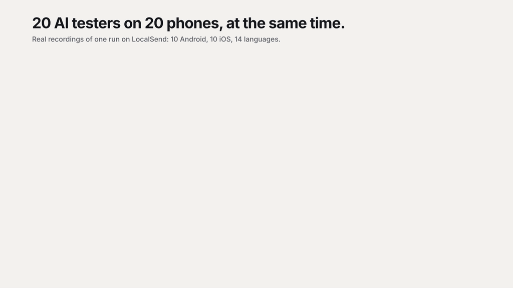
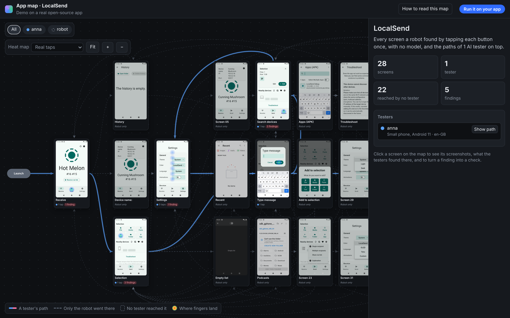

<div align="center">


# mobile-agent-testers

**20 KI-Tester auf 20 verschiedenen Smartphones, parallel, auf den kostenlosen Runnern von GitHub.**

[](https://github.com/pierridotite/mobile-agent-testers/actions/workflows/tests.yml)
[](https://github.com/pierridotite/mobile-agent-testers/stargazers)
[](../../LICENSE)


**[Beispiele](docs/examples.md)** · **[Dashboard-Demo](https://pierridotite.github.io/mobile-agent-testers/)** · **[Vergleich](../../docs/compare.md)** · **[FAQ](docs/faq.md)** · **[Personas](../../personas.json)** · **[Mitwirken](../../CONTRIBUTING.md)**

<sub>[English](../../README.md) · [简体中文](../zh-CN/README.md) · [日本語](../ja/README.md) · [Español](../es/README.md) · [Português](../pt-BR/README.md) · [Tiếng Việt](../vi/README.md) · [Türkçe](../tr/README.md) · Deutsch · [हिन्दी](../hi/README.md) · [한국어](../ko/README.md)</sub>

<a href="https://www.linkedin.com/in/pierre-raffalli/"><picture><source media="(prefers-color-scheme: dark)" srcset="../../assets/linkedin-follow-dark.svg"></picture></a>
<a href="https://discord.gg/WuaCANscr8"><picture><source media="(prefers-color-scheme: dark)" srcset="../../assets/discord-join-dark.svg"></picture></a><br>
<a href="https://trendshift.io/repositories/371956?utm_source=trendshift-badge&amp;utm_medium=badge&amp;utm_campaign=badge-trendshift-371956" target="_blank" rel="noopener noreferrer"></a>
<a href="https://trendshift.io/repositories/371956?utm_source=trendshift-badge&amp;utm_medium=badge&amp;utm_campaign=badge-trendshift-371956" target="_blank" rel="noopener noreferrer"></a>

<sub>Diese Seite ist aus dem Englischen übersetzt und kann leicht hinterherhinken; maßgeblich ist die [README.md](../../README.md).</sub>

</div>

<p align="center"><a href="../../assets/launch-video.mp4"></a><br>
<sub>Die Smartphones sind echte Bildschirmaufnahmen des LocalSend-Laufs; die Karte ist das Dashboard auf der <a href="../../demo-app/">Demo-App</a>. <a href="../../assets/launch-video.mp4">Video mit Ton (MP4)</a> · <a href="../../assets/localsend-20.mp4">Die 20 Smartphones, vollständige Aufnahme</a> · <a href="../../docs/runs/localsend-20.md">Der Lauf, Gerät für Gerät</a></sub></p>

Keine Testskripte zum Schreiben. Jeder Tester ist ein Claude-Code-Agent mit eigenem iOS
Simulator oder Android-Emulator auf GitHub Actions. Er spielt eine Persona (iPhone SE
auf Schwedisch mit größter Schriftgröße, Pixel 7 bei 200 %, iPad auf Deutsch, Arabisch
von rechts nach links ...), benutzt deine App wie ein neuer Nutzer (oder arbeitet das Feature
durch, auf das du ihn hinweist) und schreibt einen Fehlerbericht mit Screenshots. Flutter,
React Native, Expo, natives Kotlin und Swift, Kotlin Multiplatform, Capacitor und .NET MAUI.

Die Runner von GitHub sind für öffentliche Repos kostenlos. Du zahlst nur für das Modell, mit
deinem Claude-Abonnement oder API-Key: etwa 0,15 bis 0,55 $ pro Smartphone in
[diesen Läufen](../../docs/runs/).

## Schnellstart

```bash
gh repo create my-testers --public --template pierridotite/mobile-agent-testers --clone
cd my-testers && ./setup.sh           # key pair + secrets + Claude token (Windows: .\setup.ps1)
gh workflow run agent-testers.yml     # demo: 2 Android + 2 iOS testers, ~20 min
bash scripts/collect.sh <run id>      # decrypts reports, writes runs/<id>/SUMMARY.md
```

Danach für deine eigene App:

```bash
gh workflow run agent-testers.yml -f source_repo=you/app -f app_id=com.you.app \
  -f android_personas=anna,malik -f ios_personas=clara,jonas
```

Oder lass Claude das Setup für dich übernehmen: `/plugin marketplace add pierridotite/mobile-agent-testers`, dann `/plugin install mobile-agent-testers@mobile-agent-testers`.

Alle Eingaben (Builds, Briefs, Fehlerberichte, günstigere Modelle, Build-Argumente, Video) und die unterstützten Frameworks: [docs/configuration.md](docs/configuration.md).

<details>
<summary>Was der Demo-Lauf findet</summary>

Die Demo-App hat [11 absichtlich eingebaute Bugs](../../demo-app/BUGS.md). In [einem Lauf](../../docs/runs/) fanden die 4 Demo-Tester 9 davon (2 bis 7 Minuten pro Agent, insgesamt etwa 21 Minuten für den ganzen Lauf, inklusive Builds), dazu echte Probleme, die niemand eingepflanzt hat (ein Button unter der Android-Navigationsleiste, nach einem Neustart bleiben keine Daten erhalten). Modellnutzung: 0,87 $ für die 4.

</details>

## Was es tut

Jede Persona erkundet deine App wie ein neuer Nutzer und meldet, was im Weg steht, mit nummerierten Screenshots. Ein Lauf kann auch ein Feature von Anfang bis Ende durchlaufen, einen Fehlerbericht reproduzieren, einen Verbesserungsbericht schreiben, zwei Versionen vergleichen oder eine Website auf Smartphones testen. Ein Einsatz pro Lauf, festgelegt mit den Eingaben oben.

<details>
<summary>Die sechs Einsätze, einer nach dem anderen</summary>

| Einsatz | Was du bekommst |
|---|---|
| **Wie neue Nutzer erkunden** (Standard) | Jede Persona versucht, ihr Ziel zu erreichen, und meldet, was im Weg steht, mit nummerierten Screenshots. |
| **Ein Feature von Anfang bis Ende durchlaufen** | Dein Brief schickt jeden Agenten durch eine ganze Mechanik: Tippen, Wischen, Eingeben, Neustarts, Deep Links. [AnkiDroids Brief](../../briefs/ankidroid.md) fand das Rückseitenfeld einer neuen Karte, das hinter der Tastatur versteckt war. |
| **Einen Fehlerbericht reproduzieren** | Jedes Smartphone antwortet mit Ja, Nein oder Unklar, mit Screenshots ([Brief](../../briefs/reproduce.md)). |
| **Einen Verbesserungsbericht erhalten** | Wo jede Persona zögerte, was sie erwartete, was zuerst zu ändern ist ([Brief](../../briefs/improve.md)). |
| **Zwei Versionen vergleichen** | Dieselben Personas auf zwei Branches oder Builds, danach eine Tabelle mit Zielen, Bewertungen und Problemen ([Anleitung](../../docs/compare-versions.md)). |
| **Eine Website auf Smartphones testen** | Dieselben Personas im Browser eines Smartphones, auf jeder Website oder Web-App. Läuft auf kostenlosen Linux-Runnern ([Konfiguration](docs/configuration.md)). |

</details>

Jedes Anthropic-kompatible Modell funktioniert, von Claude Haiku über OpenRouter, DeepSeek, Kimi, GLM, MiniMax bis Qwen; die Funde sind nur so gut wie das Lesen der Screenshots durch das Modell ([docs/cheaper-models.md](../../docs/cheaper-models.md)). Maestro oder Appium führen die Tests aus, die du schreibst; diese Agenten suchen, was niemand zu testen gedacht hat ([Vergleich](../../docs/compare.md)).

## Jeder Bildschirm auf einer Karte

<a href="https://pierridotite.github.io/mobile-agent-testers/"></a>

Alle Bildschirme, die die Tester erreicht haben, mit dem Pfad jedes einzelnen in eigener Farbe und einer Heatmap der Tipppunkte. Wähle im Device-Menü ein Gerät aus, um die Bildschirme in seiner Form (Telefon oder Tablet) und mit seiner eigenen Heatmap zu sehen. Kommentiere einen Bildschirm oder mach daraus, was darauf falsch ist, eine Prüfung.

<p align="center"><a href="https://pierridotite.github.io/mobile-agent-testers/"><picture><source media="(prefers-color-scheme: dark)" srcset="../../assets/demo-try-dark.svg"></picture></a></p>

Bei deinem eigenen Lauf: `python3 scripts/dashboard.py runs/<id>`. Er läuft auf deinem Rechner, und die Ergebnisse verlassen ihn nie ([docs/dashboard.md](../../docs/dashboard.md)).

## Aus jedem Bug wird ein Test

Ein Tester, der einen Bug findet, ist einen Weg gegangen, den kein Skript geschrieben hätte. Jeder Android-Tester speichert diesen Weg als Trace, wobei jeder Tipp nach dem Element unter dem Finger benannt wird. Mit `-f replay_path=true` wird der Pfad direkt nach dem Agenten auf demselben Smartphone ohne Modell abgespielt. Eine auf der Karte hinzugefügte Prüfung macht den Bug zum Teil des Tests: Der Replay meldet `bug`, solange er da ist, und `fixed`, wenn er weg ist ([docs/replay.md](../../docs/replay.md)).

Die Traces folgen Explore-Compile-Replay, meinem offenen Format, das den Pfad eines Agenten in einen [Maestro](https://maestro.dev)-Flow kompiliert. Bisher nur Android; ECR ist ein früher Entwurf.

<p align="center"><a href="https://github.com/pierridotite/explore-compile-replay"><picture><source media="(prefers-color-scheme: dark)" srcset="../../assets/ecr-button-dark.svg"></picture></a></p>

## Echte Läufe

Open-Source-Apps, ohne eingepflanzte Fehler. In [LocalSend](https://github.com/localsend/localsend) (Flutter, 100k Sterne) fanden 20 Smartphones in 14 Sprachen in 69 Minuten 46 verschiedene Bugs für 4,62 $ Modellnutzung. Einer ist ein Blocker: Auf einem iPhone SE auf Schwedisch mit größter Schriftgröße kannst du überhaupt keine Textnachricht senden.

<details>
<summary>Die drei Läufe: LocalSend, AnkiDroid, Flutters Animations-Beispiel</summary>

| App | Smartphones | Was die Agenten fanden | Zeit, Modellnutzung |
|---|---|---|---|
| [LocalSend](https://github.com/localsend/localsend) (Flutter, 100k Sterne) | 20: 10 Android, 10 iOS, 14 Sprachen | 46 verschiedene Bugs, 1 Blocker: Auf einem iPhone SE auf Schwedisch mit größter Schriftgröße kannst du überhaupt keine Textnachricht senden | 69 Min., 4,62 $ |
| [AnkiDroid](https://github.com/ankidroid/Anki-Android) (Kotlin, 12k Sterne, Release-APK) | 10 Android | 43 verschiedene Probleme, darunter Antwortbuttons, die bei 200 % Schriftgröße halbiert werden, und „Get started“ in drei Sprachen auf Englisch | unter 10 Min., 4,69 $ |
| [Flutters Animations-Beispiel](https://github.com/flutter/packages/tree/main/packages/animations/example) | 1 Android, 1 iOS | Derselbe Tippfehler, von beiden Agenten unabhängig gemeldet, und eine App, die den Dunkelmodus ignoriert | 19 Min., 0,47 $ |

</details>

34 von LocalSends 46 Bugs hatten nichts mit Schriftgröße oder Barrierefreiheit zu tun: unterbrochene Abläufe, stille Fehlschläge, fehlende Übersetzungen, Tablet-Layouts. Screenshots, jeder Fund und die Befehle, um sie erneut zu laufen: [docs/examples.md](docs/examples.md).

## Mitwirken

[Issues warten auf Übernahme](https://github.com/pierridotite/mobile-agent-testers/issues/9), einige davon [good first issues](https://github.com/pierridotite/mobile-agent-testers/labels/good%20first%20issue): neue Personas, ein anderes Agent-CLI, GitLab CI, Übersetzungen. Kommentiere das Issue, das du übernimmst, damit nicht zwei dasselbe bauen. [CONTRIBUTING.md](../../CONTRIBUTING.md) sagt, wo jedes anfängt und wie man es offline testet. Pull Request gemerged oder auf deiner App gelaufen? [Zeig deine Arbeit](../../docs/share.md). Fragen: [Discord](https://discord.gg/WuaCANscr8).

## Gehostete Version für Teams (in Erprobung)

Der Workflow hier bleibt kostenlos, quelloffen und vollständig. Ich erprobe eine gehostete Version für Teams mit privaten Apps: inklusive macOS-Runnern (in einem privaten Repo zählt GitHub jede macOS-Minute zehnfach) und einem Web-Dashboard, um die Berichte mit dem ganzen Team zu teilen, Produktmanager eingeschlossen.

Würde das deinem Team helfen? [Beantworte drei Fragen](https://github.com/pierridotite/mobile-agent-testers/issues/new?template=teams.yml) oder [schreib mir auf LinkedIn](https://www.linkedin.com/in/pierre-raffalli/). Schon auf deiner App gelaufen? [Erzähl mir, was es gefunden hat und was im Weg stand](https://github.com/pierridotite/mobile-agent-testers/issues/new?template=usage-feedback.yml).

## Star-Verlauf

[](https://star-history.com/#pierridotite/mobile-agent-testers&Date)

## Danksagung

[Claude Code](https://docs.claude.com/en/docs/claude-code) ·
[AXe](https://github.com/cameroncooke/axe) ·
[android-emulator-runner](https://github.com/ReactiveCircus/android-emulator-runner)

## Mitwirkende

Allen, die beigetragen haben, danke. Willst du helfen? [Hier starten](../../CONTRIBUTING.md).

<a href="https://github.com/pierridotite/mobile-agent-testers/graphs/contributors"></a>

Gemacht von Pierre Raffalli · [LinkedIn](https://www.linkedin.com/in/pierre-raffalli/) · [GitHub](https://github.com/pierridotite) · [Discord](https://discord.gg/WuaCANscr8) · MIT-Lizenz
