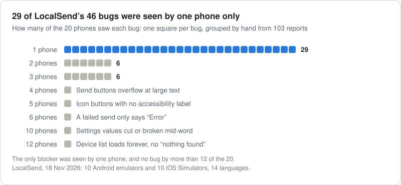

# 실제 적용 사례

[English](../../../docs/examples.md) · [简体中文](../../zh-CN/docs/examples.md) · [日本語](../../ja/docs/examples.md) · [Español](../../es/docs/examples.md) · [Português](../../pt-BR/docs/examples.md) · [Tiếng Việt](../../vi/docs/examples.md) · [Türkçe](../../tr/docs/examples.md) · [Deutsch](../../de/docs/examples.md) · [हिन्दी](../../hi/docs/examples.md) · 한국어

아무것도 심어 두지 않은 오픈 소스 앱에서의 실제 실행입니다. 모든 수치는 [실행 기록](../../../docs/runs/)에서 확인할 수 있으며, 각 보고서가 기기별로 정리되어 있습니다.

## 접근성만의 문제가 아닙니다

큰 글자는 가장 눈에 띄는 스크린샷을 만들지만, 에이전트가 보고하는 내용에서 차지하는 비중은 작습니다. 각 페르소나에는 목표가 있고("영어 없이 작업 하나 끝내기", "모든 텍스트 필드를 터키어 문자, 이모지, 아주 긴 텍스트로 채우기", "앱을 중간에 떠났다가 다시 돌아오기") 신규 사용자처럼 그 목표에 도달하려고 하므로, 에이전트는 방해가 되는 모든 것을 보고합니다.

- **끊긴 흐름과 조용한 실패**: 기기 목록이 영원히 로딩되면서 아무것도 찾지 못했다는 말을 하지 않는 경우(휴대폰 20대 중 12대), 실패한 전송이 "Error"만 표시하는 경우, 주소가 응답하지 않을 때 대화상자가 영원히 기다리는 경우, 한 번 잘못 탭했다고 입력한 내용을 버리는 텍스트 대화상자.
- **온보딩과 권한**: AnkiDroid는 시스템 페이지에서 모든 파일 접근 권한을 허용할 때까지 아무 설명 없이 설정을 막습니다(에이전트 10개 중 8개).
- **번역**: 포르투갈어, 스페인어, 일본어 휴대폰에서 "Get started"가 영어로 남아 있음, 포르투갈어에서 # 탭이 "Jogo da velha"(틱택토)로 표시됨, 아랍어에서 파일 크기가 "B 14"로 표기됨, 휴대폰 형식 대신 ISO 날짜 사용, 개인정보 처리방침이 영어로만 제공됨.
- **문구**: Flutter 공식 샘플의 오타, 문자 메시지가 "Files: 1"로 집계됨, 설명 없이 홈 화면에 표시되는 "#16 #15".
- **기기**: 태블릿에서 휴대폰 레이아웃이 좁은 열로 표시됨, 키보드가 Cancel과 Confirm을 가림, Android 내비게이션 바가 목록의 마지막 항목을 가림, 앱이 다크 모드를 무시함.
- **데이터**: 앱을 다시 실행하면 아무것도 유지되지 않음(데모 앱).

LocalSend에서는 46개 버그 중 34개가 글자 크기나 접근성과 무관했습니다. 모든 보고서는 페르소나의 의견과 10점 만점 점수(이 앱을 계속 쓸 것인가?)로 끝나므로, 한 번의 실행으로 무엇이 고장 났는지뿐 아니라 신규 사용자가 어디서 길을 잃는지도 알 수 있습니다.

## LocalSend: 에이전트 20개, 기기 20대, 14개 언어

<p align="center"></p>

[LocalSend](https://github.com/localsend/localsend)는 스타 10만 개의 Flutter 앱입니다. 에이전트가 발견한 것은 다음과 같습니다:

- 최대 텍스트 크기의 스웨덴어 iPhone SE: 메시지 대화상자가 149 px 넘쳐 입력 필드와 Confirm이 화면 밖으로 나가고, 문자를 전혀 보낼 수 없습니다.
- Android 글꼴 200%의 Pixel 7: Send 버튼 여섯 개가 모두 넘쳐 레이블이 반으로 잘립니다. 이탈리아어로 첫 번째 접근성 크기를 쓴 iPhone 16 Plus에서도 같습니다.
- 큰 텍스트의 독일어 iPad Air: "Hinzufügen"이 카드 밖으로 114 px 넘치고, Settings 값이 단어 중간에서 줄바꿈됩니다.
- 기본 텍스트 크기의 프랑스어 iPhone SE: "Recevoir via un lien"이 28 px 넘쳐 체크박스를 가립니다.
- 스페인어 Pixel Tablet: 키보드가 주소 대화상자의 Cancel과 Confirm을 가립니다.
- 수동 전송이 실패하면 이유 없이 "Error", "Erreur", "Fehler", "エラー", "Hata", "Erro" 중 하나만 표시됩니다. iOS에서는 주소가 응답하지 않으면 진행 상황 표시 없이 대화상자가 계속 기다립니다(에이전트 3개).

총 103개의 보고서(차단 1개, 주요 15개)입니다. 직접 묶어 보면 서로 다른 버그 46개이며, 대부분은 한 대의 휴대폰에서만 발견되었습니다:

<picture>
  <source media="(prefers-color-scheme: dark)" srcset="../../../assets/bugs-per-phone-dark.svg">
  
</picture>

시작부터 마지막 보고서까지 69분(무료 플랜은 macOS 작업을 한 번에 5개 실행), 20개 에이전트의 모델 사용량은 $4.62입니다. 기기별 모든 보고서: [docs/runs/localsend-20.md](../../../docs/runs/localsend-20.md). 직접 실행하려면:

```bash
gh workflow run agent-testers.yml -f source_repo=localsend/localsend -f app_dir=app \
  -f app_id=org.localsend.localsend_app -f android_personas=all -f ios_personas=all -f record_video=true
```

## AnkiDroid: 에이전트 10개, 릴리스 APK 그대로

<p align="center"></p>

[AnkiDroid](https://github.com/ankidroid/Anki-Android)는 스타 1.2만 개의 Kotlin 앱입니다. Android 에뮬레이터 10대에서 에이전트 10개가 GitHub 릴리스의 APK를 그대로 사용했고, 빌드는 없었습니다:

- Android 글꼴 200%의 Pixel 7: Again / Hard / Good / Easy 버튼이 반으로 잘리고, 통계 텍스트가 오른쪽 가장자리를 넘어갑니다. 다른 에이전트는 2.26 알파에서도 버튼이 잘린 것을 발견했으며, "Show large answer buttons"를 켜면 두 줄 모두 그렇습니다.
- 포르투갈어, 스페인어, 일본어로 설정된 기기에서 환영 화면의 "Get started"가 영어로 표시되지만 화면의 나머지는 번역되어 있습니다(에이전트 세 개가 각자 발견).

보고서 83개는 서로 다른 이슈 43개로 묶입니다(그중 2개는 앱이 아니라 Android 10 및 11 에뮬레이터 이미지의 오래된 시스템 WebView에서 비롯됨). 시작부터 마지막 보고서까지 10분 미만, 10개 에이전트의 모델 사용량은 $4.69입니다. 모든 보고서: [docs/runs/ankidroid-10.md](../../../docs/runs/ankidroid-10.md). 직접 실행하려면:

```bash
gh workflow run agent-testers.yml -f app_dir=. -f app_id=com.ichi2.anki -f brief=briefs/ankidroid.md \
  -f android_build="curl -fsSL -o anki.apk https://github.com/ankidroid/Anki-Android/releases/download/v2.25.3/AnkiDroid-2.25.3-full-universal.apk" \
  -f apk_path=anki.apk -f android_personas=all -f ios_personas=none -f block_hosts="ankiweb.net www.google-analytics.com"
```

## Flutter 공식 애니메이션 샘플

<p align="center"></p>

[flutter/packages의 예제 앱](https://github.com/flutter/packages/tree/main/packages/animations/example)에서 Pixel 7의 에이전트와 프랑스어 iPhone SE의 에이전트가 각각 같은 오타 "Streamling your courses"([110번째 줄](https://github.com/flutter/packages/blob/main/packages/animations/example/lib/shared_axis_transition.dart#L110))를 보고했고, Android 쪽 에이전트는 앱이 다크 모드를 무시한다는 것도 알아챘습니다. 19분, 모델 사용량 $0.47.

자신의 앱에서 실행해 보셨나요? [발견한 내용을 공유해 주세요](https://github.com/pierridotite/mobile-agent-testers/issues/new?title=Finding:%20) 그러면 [실행 기록](../../../docs/runs/)에 추가됩니다. 이 앱 중 하나를 유지 관리하고 있고 발견 사항이 잘못되었다고 생각되면 이슈를 열어 주세요. 수정한 뒤 다시 실행하겠습니다.
